# Uber NCR Ride Operations Analytics

**An end-to-end analytics project on 150,000 Delhi NCR ride bookings from 2024: a Python audit and cleaning notebook, a star-schema model in Power BI, a 7-page interactive dashboard built around one question (*where do bookings succeed, and where are they lost?*), and a requirements and test plan with a reproducible figure check.**

*Independent portfolio project by Harshvardhan Singh. It is not affiliated with or endorsed by Uber. The vehicle illustrations and icons were drawn for this project.*

[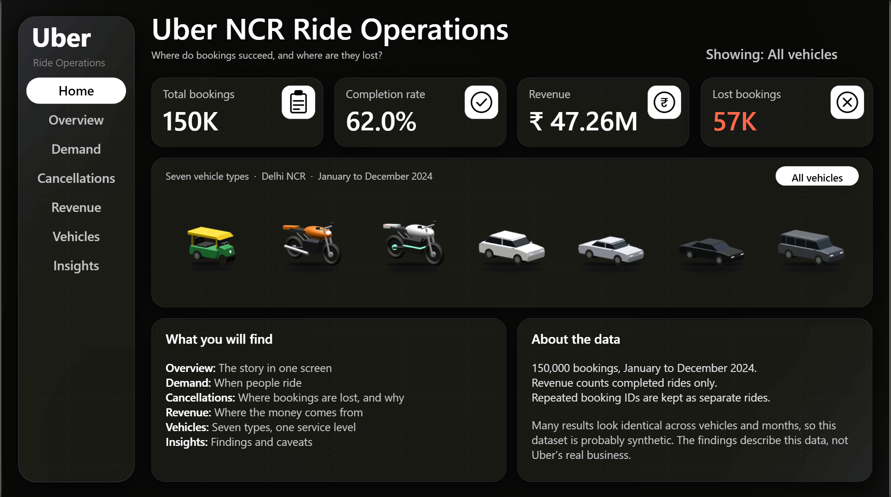](docs/screenshots/01-home.png)

> **About the data.** The dataset appears to be synthetic: completion rate, average fare, ratings, wait times and hourly patterns are almost identical across vehicles, months and locations. Every finding below describes **this dataset**, not Uber's real business. The dashboard says so on the Home and Insights pages.

---

## Table of contents

1. [Project at a glance](#1-project-at-a-glance)
2. [Business context and objectives](#2-business-context-and-objectives)
3. [Executive summary](#3-executive-summary)
4. [Dashboard tour](#4-dashboard-tour)
5. [Key findings](#5-key-findings)
6. [Recommendations](#6-recommendations)
7. [Architecture and workflow](#7-architecture-and-workflow)
8. [Source data](#8-source-data)
9. [Data audit: what was checked and what was found](#9-data-audit-what-was-checked-and-what-was-found)
10. [Cleaning and transformation approach](#10-cleaning-and-transformation-approach)
11. [Data model](#11-data-model)
12. [Power BI build](#12-power-bi-build)
13. [Requirements and user acceptance testing (UAT)](#13-requirements-and-user-acceptance-testing-uat)
14. [Validation and reconciliation](#14-validation-and-reconciliation)
15. [Challenges and lessons learned](#15-challenges-and-lessons-learned)
16. [Limitations and caveats](#16-limitations-and-caveats)
17. [Future work](#17-future-work)
18. [Repository structure](#18-repository-structure)
19. [How to reproduce this project](#19-how-to-reproduce-this-project)
20. [Skills demonstrated](#20-skills-demonstrated)
21. [Glossary](#21-glossary)
22. [Data source and credits](#22-data-source-and-credits)
23. [Author](#23-author)

---

## 1. Project at a glance

| Item | Detail |
|---|---|
| **Question** | Where do ride bookings succeed, and where are they lost? |
| **Data** | 150,000 Delhi NCR ride bookings, 1 January to 30 December 2024 (365 days), 21 raw columns |
| **Data cleaning** | Python (pandas) in `uber_ride_analysis.ipynb`: IDs, dates, repeated booking IDs, outcome flags, audit |
| **Model** | Power BI star schema: one `Rides` fact table (150,000 rows, 27 columns) and three dimensions (`DimDate`, `DimTime`, `DimVehicle`) |
| **Dashboard** | 7 pages: Home, Overview, Demand, Cancellations, Revenue, Vehicles, Insights |
| **Measures** | 40+ DAX measures in one `_Measures` table |
| **Interactivity** | Fleet selector (bookmarks), synced date and vehicle slicers, Month/Quarter field parameter, data-driven colour rules |
| **Quality checks** | 18 UAT test cases traced to the requirements (all passed) plus `tests/verify_figures.py`, which recomputes 28 figures from the data |
| **Tools** | Python (pandas, NumPy, matplotlib, seaborn), Jupyter, Power BI Desktop, Power Query, DAX |

---

## 2. Business context and objectives

**Context.** A ride operations team needs to understand how many bookings turn into completed rides, where the rest are lost, and what that costs.

**Users (fictional personas used for practice):**

- **Operations Manager:** decides where to add drivers and when to run incentives.
- **Analyst:** checks the figures and drills into cancellations.

**Business questions the dashboard answers:**

| # | Question | Answered on |
|---|---|---|
| 1 | What share of bookings are completed? | Home, Overview |
| 2 | Who causes cancellations, drivers or customers, and why? | Cancellations |
| 3 | When is demand highest and lowest? | Demand |
| 4 | Do vehicle types differ in performance? | Vehicles |
| 5 | How much revenue is at risk from lost bookings? | Overview, Cancellations, Insights |

**Business problem.** Of 150,000 bookings in 2024, 57,000 (38%) did not become completed rides. The operations team cannot act on that until it can see *where* bookings are lost, *why*, and *what it costs*.

**Decisions the dashboard supports:**

| Decision | Evidence on the dashboard | Page |
|---|---|---|
| Where to focus loss reduction first | Drivers cancelled 27,000 bookings (18.0%); customers 10,500 (7.0%) | Cancellations |
| When to plan driver supply | Peak at 18:00, 9.4x the quietest hour; 41.3% of bookings fall between 15:00 and 20:59 | Demand |
| What to fix at booking | Wrong address is the largest customer-controlled reason (2,362 rides) | Cancellations |
| How much the loss costs | About ₹24.4M at risk (estimate), against ₹47.26M earned | Overview, Cancellations |
| Whether vehicle-specific fixes are needed | Completion is 61.4% to 62.6% for all seven vehicle types | Vehicles |

---

## 3. Executive summary

Only **62.0%** of the 150,000 bookings in 2024 became completed rides (93,000). The other **57,000 (38%)** were lost, and drivers caused the largest share: they cancelled **27,000** bookings (18.0% of all bookings) against 10,500 for customers (7.0%), so **72% of cancellations come from drivers**. If every lost booking from a cancellation or a missing driver (48,000) had paid the average fare of ₹508, about **₹24.4M** of revenue went unearned, roughly half of the **₹47.26M** actually earned. This is an estimate, not a measured figure.

Demand follows the working day, with a peak at **18:00** (12,397 bookings, **9.4x** the quietest hour) and **41.3%** of all bookings between 15:00 and 20:59. Weekdays, months and vehicle types are strikingly flat: all seven vehicle types complete between **61.4% and 62.6%** of their bookings. That flatness is also the clearest sign that the data is synthetic.

---

## 4. Dashboard tour

### Page layout

| Page | Question it answers | Slicers | Main visuals |
|---|---|---|---|
| **Home** | What is this, and where do I start? | Fleet buttons (bookmarks) | 4 KPI cards, "Showing" label, fleet selector, data notes |
| **Overview** | What is the story in one screen? | Date, vehicle, month/quarter toggle | 6 KPI cards, booking funnel, bookings per day, vehicle leaderboard |
| **Demand** | When do people ride? | Date, vehicle | 6 KPI cards, hour-by-weekday heatmap, bookings by hour, by time slot, top 5 pickup areas |
| **Cancellations** | Where are bookings lost, and why? | Date, vehicle | 4 KPI cards, lost bookings by cause, customer reasons, driver reasons, who controls customer cancellations |
| **Revenue** | Where does the money come from? | Date, vehicle | 4 KPI cards, revenue by month, payment methods, fare distribution, revenue by vehicle category |
| **Vehicles** | Do vehicle types perform differently? | None (all 7 shown side by side) | 7 vehicle tiles, comparison table |
| **Insights** | What should the viewer take away? | None (static text) | Key findings, recommendations, definitions and data notes |

### Navigation map

A page navigator sits on every page, so any page is one click from any other. The date and vehicle slicers are synced across Overview, Demand, Cancellations and Revenue.

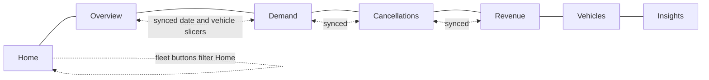

### How a booking is lost

This funnel is the backbone of the Overview page.

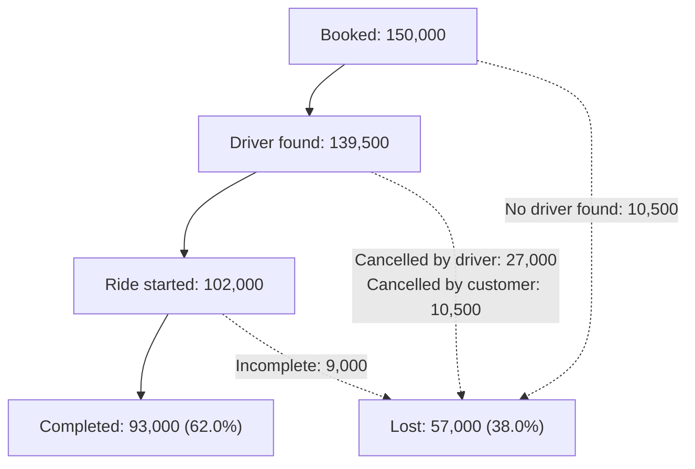

### Page 1: Home

[](docs/screenshots/01-home.png)

**Purpose:** orient the viewer and let them pick a vehicle.

- **KPI cards:** total bookings 150K, completion rate 62.0%, revenue ₹47.26M, lost bookings 57K.
- **Fleet selector:** seven vehicle illustrations with eight buttons (All vehicles plus Auto, Bike, eBike, Go Mini, Go Sedan, Premier Sedan and Uber XL). Each button applies a bookmark that filters the Home page, and a "Showing:" label confirms the current selection.
- **About the data box:** states that revenue counts completed rides only, that repeated booking IDs are kept as separate rides, and that the dataset is probably synthetic.

### Page 2: Overview

[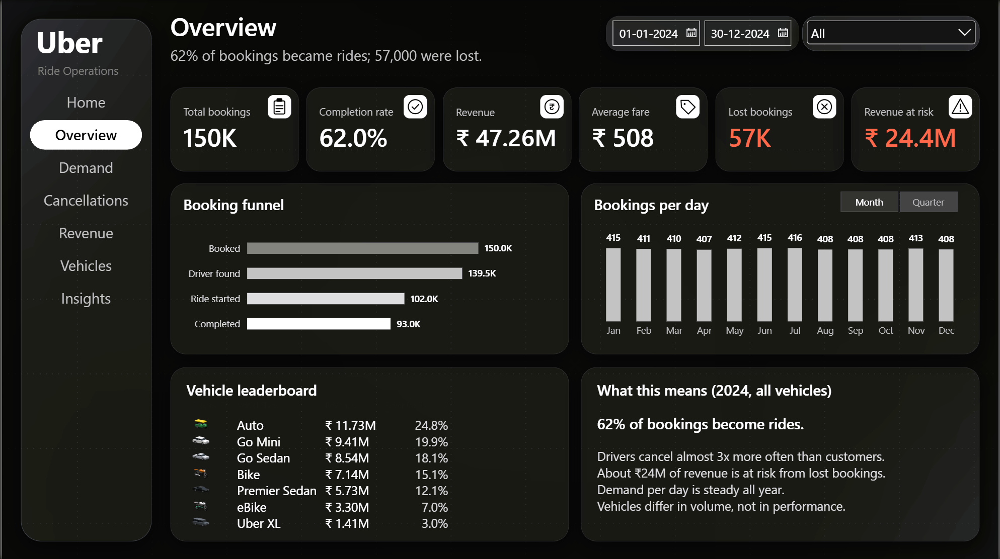](docs/screenshots/02-overview.png)

**Purpose:** the whole story on one screen. Subtitle: *62% of bookings became rides; 57,000 were lost.*

- **Six KPI cards:** total bookings 150K, completion rate 62.0%, revenue ₹47.26M, average fare ₹508, lost bookings 57K, revenue at risk ₹24.4M.
- **Booking funnel:** 150.0K booked, 139.5K driver found, 102.0K ride started, 93.0K completed.
- **Bookings per day:** steady at 407 to 416 in every month, with a Month/Quarter toggle driven by a field parameter.
- **Vehicle leaderboard:** Auto ₹11.73M (24.8%), Go Mini ₹9.41M (19.9%), Go Sedan ₹8.54M (18.1%), Bike ₹7.14M (15.1%), Premier Sedan ₹5.73M (12.1%), eBike ₹3.30M (7.0%), Uber XL ₹1.41M (3.0%).

**What we found:** the biggest drop in the funnel is between "driver found" and "ride started" (37,500 bookings), and drivers are responsible for most of it.

### Page 3: Demand

[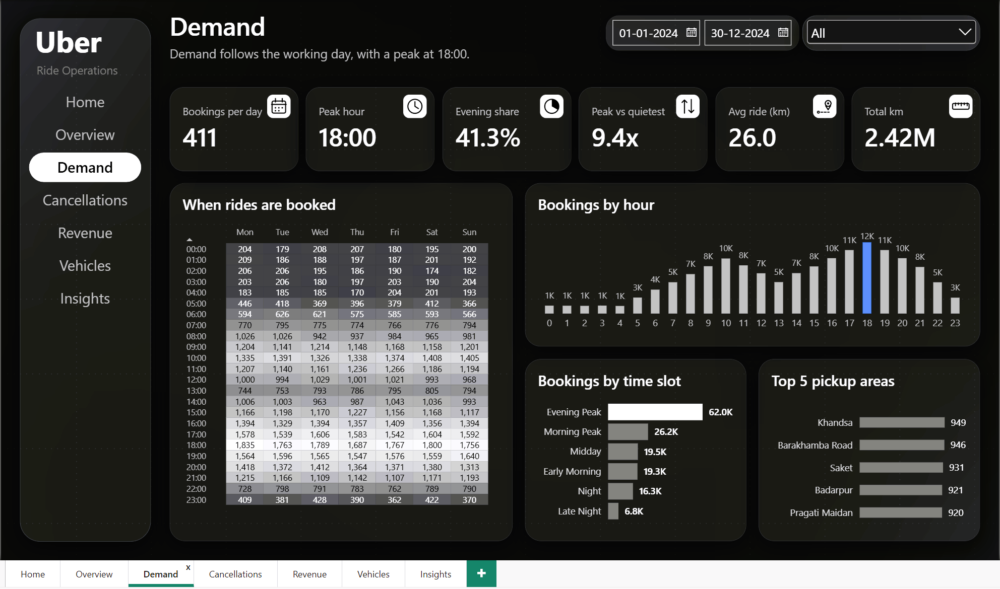](docs/screenshots/03-demand.png)

**Purpose:** show when people ride. Subtitle: *Demand follows the working day, with a peak at 18:00.*

- **KPI cards:** 411 bookings per day, peak hour 18:00, evening share 41.3%, peak vs quietest 9.4x, average ride 26.0 km, total distance 2.42M km.
- **Heatmap:** hour by weekday, with the evening band clearly brightest.
- **Bookings by hour:** the peak hour is highlighted by a measure, so the highlight follows the filters.
- **Bookings by time slot and top 5 pickup areas.**

**What we found:**

- **Daily shape:** a small morning peak at 10:00 (9,577 bookings), a lunch dip at 13:00 (5,470), and the main peak at **18:00 (12,397, 8.3% of all bookings)**. The quietest hour is 04:00 with 1,321.
- **Time slots:** Evening Peak (15:00 to 20:59) 61,953 (41.3%), Morning Peak 26,201 (17.5%), Midday 19,507 (13.0%), Early Morning 19,257 (12.8%), Night 16,306 (10.9%), Late Night 6,776 (4.5%).
- **Weekdays do not matter:** totals run from 21,215 (Thursday) to 21,644 (Monday), a 2.0% gap, and weekends hold 28.6% of bookings, which is almost exactly 2 days out of 7.
- **No pickup hotspot:** across 176 pickup areas the top five are Khandsa (949), Barakhamba Road (946), Saket (931), Badarpur (921) and Pragati Maidan (920), and even the lowest area (Ghitorni Village) has 790.

### Page 4: Cancellations

[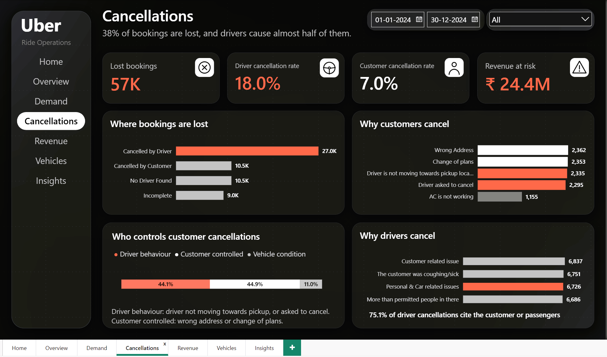](docs/screenshots/04-cancellations.png)

**Purpose:** where bookings are lost, and why. Subtitle: *38% of bookings are lost, and drivers cause almost half of them.*

- **KPI cards:** lost bookings 57K, driver cancellation rate 18.0%, customer cancellation rate 7.0%, revenue at risk ₹24.4M.
- **Where bookings are lost:** Cancelled by driver 27.0K, cancelled by customer 10.5K, no driver found 10.5K, incomplete 9.0K.
- **Why customers cancel** and **why drivers cancel** (reasons exactly as recorded in the data).
- **Who controls customer cancellations:** a 100% stacked bar split into driver behaviour, customer controlled and vehicle condition.

**What we found:**

| Group | Reason (as recorded) | Rides |
|---|---|---|
| Customer cancellations (10,500) | Wrong address | 2,362 |
| | Change of plans | 2,353 |
| | Driver is not moving towards pickup location | 2,335 |
| | Driver asked to cancel | 2,295 |
| | AC is not working | 1,155 |
| Driver cancellations (27,000) | Customer related issue | 6,837 |
| | The customer was coughing/sick | 6,751 |
| | Personal and car related issues | 6,726 |
| | More than permitted people in there | 6,686 |

- **Who controls customer cancellations:** driver behaviour **44.1%** (4,630: driver not moving towards pickup, or asked to cancel), customer controlled **44.9%** (4,715: wrong address or change of plans), vehicle condition **11.0%** (1,155).
- **Driver cancellations:** **75.1%** cite the customer or passengers (20,274 of 27,000). The four driver reasons are almost equally split (24.8% to 25.3% each), which is unusual for real data.
- **Incomplete rides (9,000):** Customer Demand 3,040, Vehicle Breakdown 3,012, Other Issue 2,948.

### Page 5: Revenue

[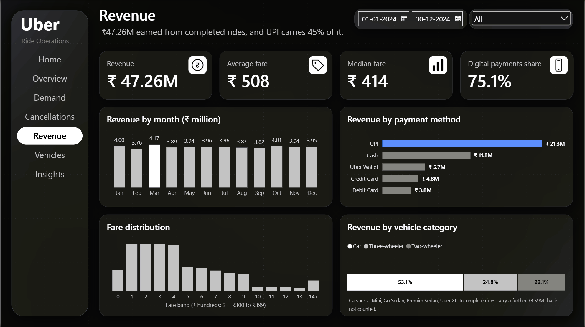](docs/screenshots/05-revenue.png)

**Purpose:** where the money comes from. Subtitle: *₹47.26M earned from completed rides, and UPI carries 45% of it.*

- **KPI cards:** revenue ₹47.26M, average fare ₹508, median fare ₹414, digital payments share 75.1%.
- **Visuals:** revenue by month, revenue by payment method, fare distribution in ₹100 bands, revenue by vehicle category.

**What we found:**

- **Months:** ₹3.76M (February) to ₹4.17M (March, the highest). February is lower mainly because the month is shorter. Completion rate stays between 61.5% and 62.6% in every month.
- **Payments:** UPI ₹21.27M (45.0%), Cash ₹11.76M (24.9%), Uber Wallet ₹5.67M (12.0%), Credit Card ₹4.75M (10.1%), Debit Card ₹3.81M (8.1%). Digital methods together are 75.1%.
- **Fares:** 61.7% of fares are under ₹500, 7.9% are ₹1,000 or more, and 3,127 fares sit above the usual range (over ₹1,371.50, up to ₹4,277), which pulls the average (₹508) above the median (₹414).
- **Vehicle category:** Car 53.1% (Go Mini, Go Sedan, Premier Sedan, Uber XL), Three-wheeler 24.8% (Auto), Two-wheeler 22.1% (Bike, eBike).
- **Excluded revenue:** incomplete rides carry a further ₹4.59M in booking value that is not counted.

### Page 6: Vehicles

[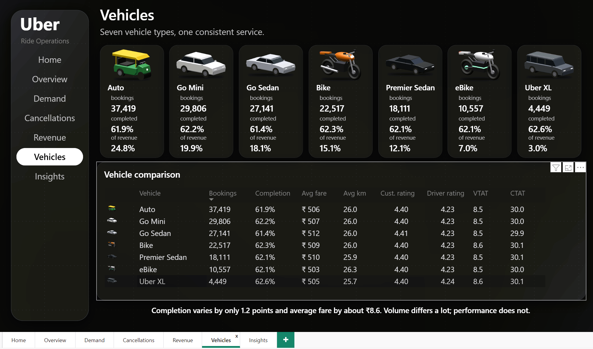](docs/screenshots/06-vehicles.png)

**Purpose:** compare the seven vehicle types. Subtitle: *Seven vehicle types, one consistent service.*

- **Seven tiles:** bookings, completion rate and share of revenue per vehicle.
- **Comparison table:** bookings, completion, average fare, average km, customer and driver ratings, VTAT and CTAT.

**What we found:** vehicles differ in **volume**, not **performance** (full table in [section 5.5](#55-vehicles)). Completion varies by only 1.2 points and average fare by about ₹8.6.

### Page 7: Insights

[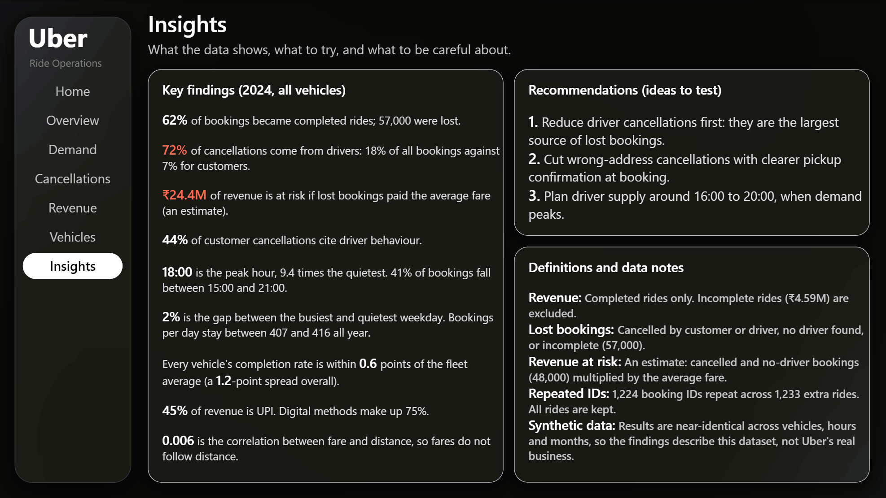](docs/screenshots/07-insights.png)

**Purpose:** what the viewer should take away.

- **Key findings (2024, all vehicles):** completion, the 72% driver share, ₹24.4M at risk, 44% of customer cancellations citing driver behaviour, the 18:00 peak, the 2% weekday gap, vehicle consistency, UPI share, and the fare-distance correlation.
- **Recommendations (ideas to test):** reduce driver cancellations first, cut wrong-address cancellations with clearer pickup confirmation, and plan driver supply around 16:00 to 20:00.
- **Definitions and data notes:** how revenue, lost bookings and revenue at risk are defined, how repeated IDs were handled, and the synthetic-data warning.

### Design system

- **Theme:** a dark, consistent theme with a navigation panel on every page.
- **Colour as meaning:** orange-red highlights what is lost or driver-caused; white and grey carry everything else. Highlights (peak hour, top revenue month, largest loss cause, UPI bar) are set by measures, so they move with the data.
- **Custom visuals:** drawn vehicle illustrations and icons used as images, with hover and selected button states.

---

## 5. Key findings

### 5.1 Completion and loss

| Outcome | Rides | Share |
|---|---|---|
| Completed | 93,000 | 62.0% |
| Cancelled by driver | 27,000 | 18.0% |
| Cancelled by customer | 10,500 | 7.0% |
| No driver found | 10,500 | 7.0% |
| Incomplete | 9,000 | 6.0% |
| **Total** | **150,000** | **100%** |

- **57,000 lost bookings (38%).** Revenue at risk is estimated at ₹24.4M: (27,000 + 10,500 + 10,500 = 48,000 cancelled or no-driver bookings) x ₹508 average fare.
- **Not counted as at risk:** the 9,000 incomplete rides, which are excluded from revenue but carry ₹4.59M in booking value.

### 5.2 Cancellations

- Drivers cause **72%** of all cancellations: **18.0%** of bookings against **7.0%** for customers.
- Customers cite driver behaviour in **44.1%** of their cancellations; drivers cite the customer or passengers in **75.1%** of theirs. These are the reasons as recorded, so they describe what the data says and not who was truly at fault.
- The single largest controllable cause is driver cancellation (27,000 rides), followed by wrong address (2,362 rides).

### 5.3 Demand

- Peak at **18:00 (12,397 bookings)**, about **9.4x** the quietest hour (04:00, 1,321).
- **41.3%** of bookings fall between 15:00 and 20:59, and the five busiest hours (16:00 to 20:00) alone hold 53,751 bookings (35.8%).
- Weekdays, weekends and months are flat: **407 to 416 bookings a day** in every month.

### 5.4 Revenue and payments

- **₹47.26M** from completed rides, average fare **₹508**, median **₹414**.
- UPI is **45.0%** of revenue; digital methods are **75.1%**; cash is 24.9%.
- Fares do not follow distance (correlation **0.006**), so revenue per kilometre is not reported as a KPI.

### 5.5 Vehicles

| Vehicle | Bookings | Completion | Driver cancel | Customer cancel | Avg fare | Avg km | Cust. rating | Driver rating | Revenue | Share |
|---|---|---|---|---|---|---|---|---|---|---|
| Auto | 37,419 | 61.9% | 17.8% | 7.2% | ₹506 | 26.0 | 4.40 | 4.23 | ₹11.73M | 24.8% |
| Go Mini | 29,806 | 62.2% | 17.9% | 7.0% | ₹507 | 26.0 | 4.40 | 4.23 | ₹9.41M | 19.9% |
| Go Sedan | 27,141 | 61.4% | 18.5% | 6.7% | ₹512 | 26.0 | 4.41 | 4.23 | ₹8.54M | 18.1% |
| Bike | 22,517 | 62.3% | 18.1% | 7.0% | ₹509 | 26.0 | 4.40 | 4.23 | ₹7.14M | 15.1% |
| Premier Sedan | 18,111 | 62.1% | 17.9% | 7.0% | ₹510 | 25.9 | 4.40 | 4.23 | ₹5.73M | 12.1% |
| eBike | 10,557 | 62.1% | 18.1% | 6.8% | ₹503 | 26.3 | 4.40 | 4.23 | ₹3.30M | 7.0% |
| Uber XL | 4,449 | 62.6% | 17.1% | 7.3% | ₹505 | 25.7 | 4.40 | 4.24 | ₹1.41M | 3.0% |

- **Volume differs, performance does not.** Auto leads revenue (24.8%) because it has the most bookings, not because it performs better. Completion is within 0.6 points of the fleet average (a 1.2-point spread), and average fare spans only ₹503 to ₹512.
- **By category:** Car 53.1% of revenue, Three-wheeler 24.8%, Two-wheeler 22.1%.
- **Why it matters:** with performance this uniform, the lever for revenue is volume (supply and demand in the evening peak), not vehicle-specific fixes. In real data this uniformity would be suspicious, which is why the dataset is flagged as probably synthetic.

### 5.6 Customers and ratings

- **Customers almost never repeat:** 1,206 of 148,788 customers booked more than once, so there is no customer-segment analysis.
- **Ratings:** completed rides have customer ratings averaging 4.40 and driver ratings averaging 4.23, all between 3.0 and 5.0.
- **Wait times:** average VTAT is 8.5 and average CTAT is 30.0 for completed rides (29.1 across all rides that have a value), and both are the same for every vehicle type to within a few tenths. The dataset does not define either measure, so they are shown by name only.

### 5.7 Fares and distance

- **Average ride 26.0 km** (2.42M km in total), spread almost evenly across distance bands: 0-10 km 15,524 rides, 10-20 km 19,220, 20-30 km 19,508, 30-40 km 19,500, 40+ km 19,248.
- **Fares are not distance-based:** correlation 0.006, with the same average fare for short and long rides.
- **Long tail:** 3,127 fares above ₹1,371.50 (up to ₹4,277) lift the mean above the median.

### 5.8 What stays constant (and why it matters)

Completion rate (61.5% to 62.6% by month, 60.9% to 63.7% by hour), average fare, ratings and wait times barely move across vehicles, months, hours and weekdays. Real ride data almost never behaves this way, which is the main reason this project treats the data as synthetic and limits its claims accordingly.

### Notebook charts

| | |
|---|---|
| 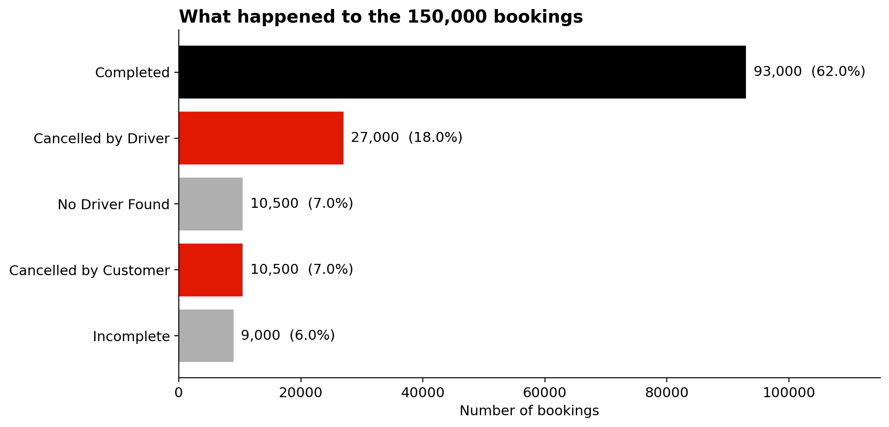 | 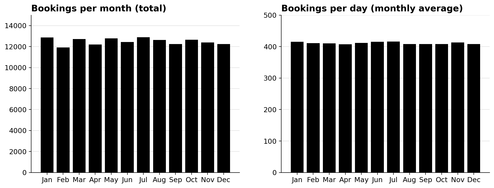 |
| Booking outcomes | Monthly bookings |
| 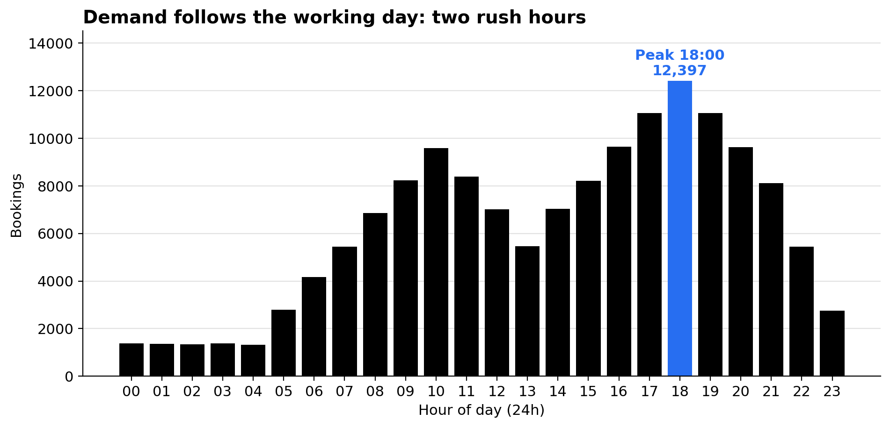 | 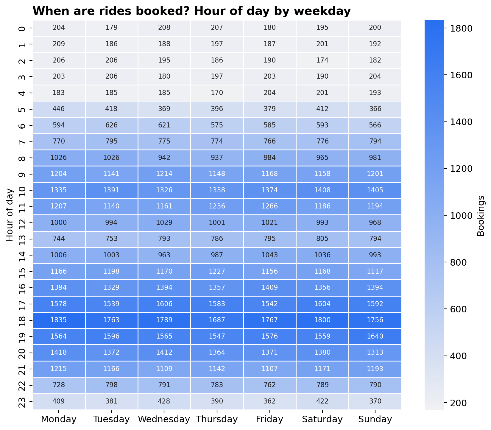 |
| Hourly demand | Hour-by-weekday heatmap |
| 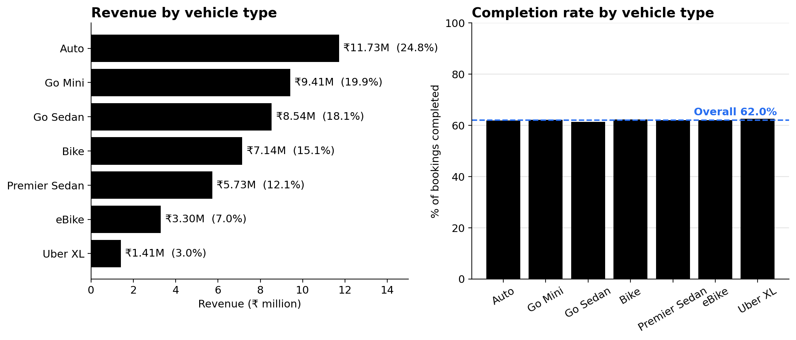 | 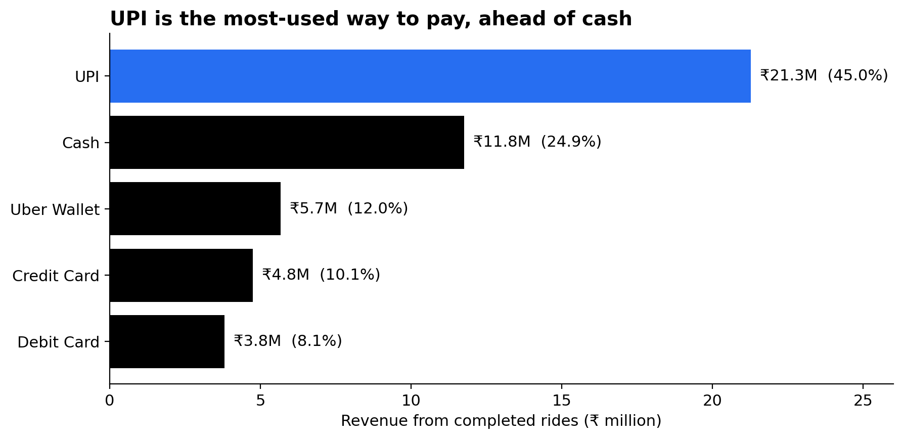 |
| Vehicle comparison | Payments |
| 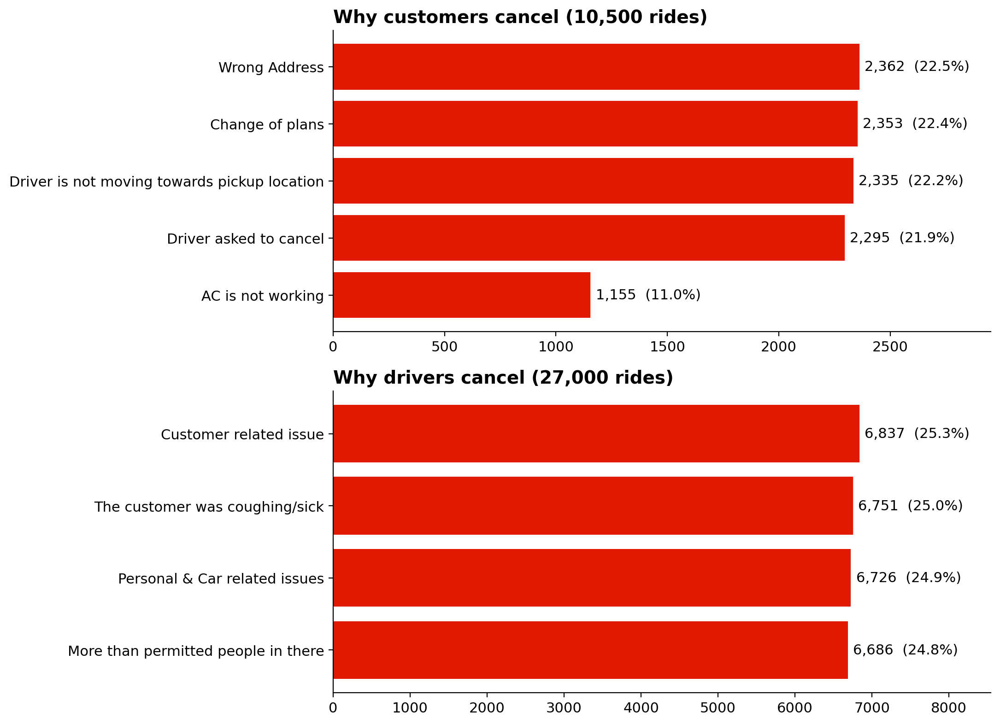 | 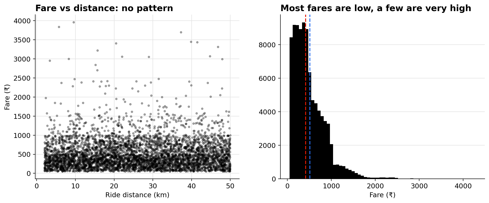 |
| Cancellation reasons | Fare distribution |
| 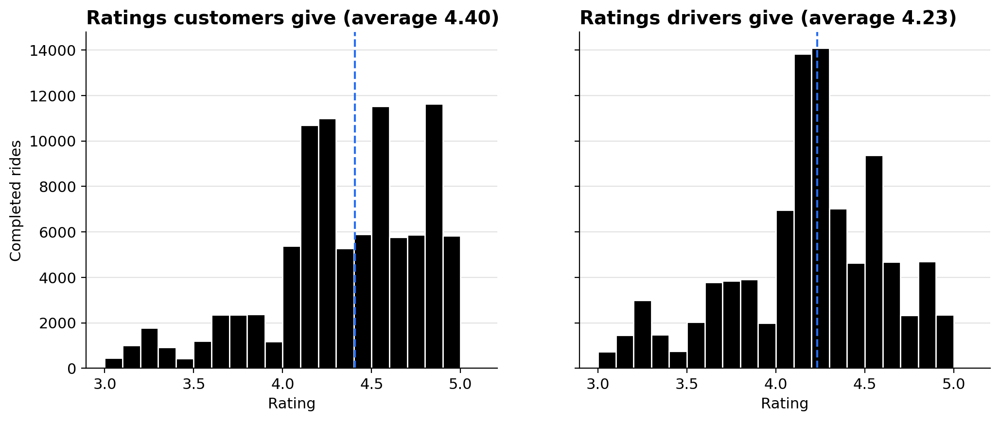 | 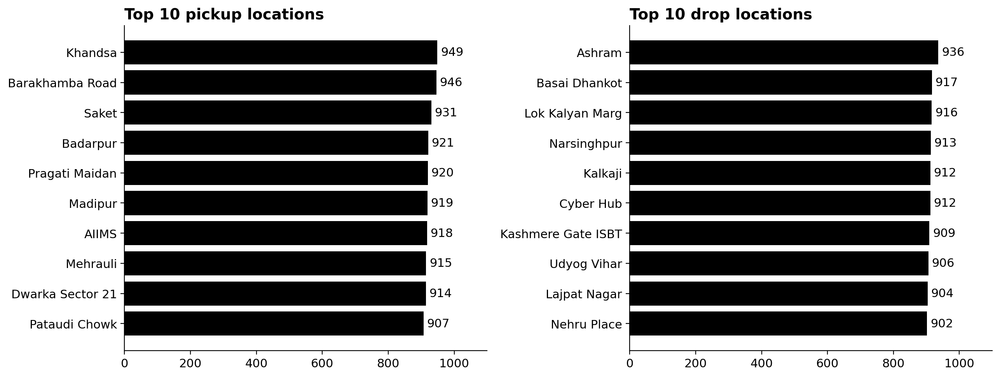 |
| Ratings | Pickup and drop locations |

---

## 6. Recommendations

These are **ideas to test**, not proven causes. Reasons in the data are recorded, not verified.

1. **Reduce driver cancellations first.** They are the largest single source of lost bookings (27,000 rides, 18.0% of all bookings). Start by finding out why drivers cancel before changing incentives.
2. **Reduce wrong-address cancellations** (2,362 rides) with clearer pickup confirmation at booking. This is the largest cancellation reason that the customer side can fix.
3. **Plan driver supply around 16:00 to 20:00,** when demand is highest and 41.3% of bookings fall between 15:00 and 20:59.
4. **Check how reasons are captured.** Four driver reasons sit within 24.8% to 25.3% of each other, and the customer reasons are nearly equal too. A cleaner reason taxonomy would make cancellation analysis more trustworthy.
5. **Measure a real before-and-after.** A pickup-confirmation change could be tested by comparing wrong-address cancellations before and after, which this dataset cannot show on its own.

---

## 7. Architecture and workflow

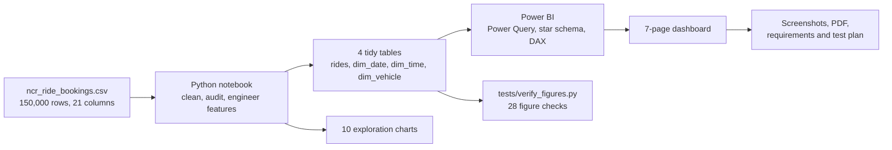

### Project phases

1. **Load and profile** the raw CSV. Blanks are meaningful: a cancelled ride has no fare or rating.
2. **Clean** IDs and dates, and decide how to treat repeated booking IDs.
3. **Engineer features:** hour, weekday, month, quarter, time slot, distance band and one 1/0 flag per booking outcome.
4. **Audit data quality** (section 9).
5. **Explore and chart** demand, cancellations, vehicles, payments, fares and ratings.
6. **Export four tidy tables** for Power BI.
7. **Model and build** the star schema, measures and seven pages.
8. **Write requirements and test** (section 13).
9. **Verify the figures** with an independent script (section 14).

---

## 8. Source data

A public Kaggle dataset of Delhi NCR ride bookings (`ncr_ride_bookings.csv`): **150,000 rows and 21 columns**, covering 1 January to 30 December 2024, with 176 pickup areas, 176 drop areas and 7 vehicle types.

| Column group | Raw columns | Blank values (meaning) |
|---|---|---|
| Identity | Booking ID, Customer ID | None |
| Time | Date, Time | None |
| Outcome | Booking Status | None |
| Trip | Vehicle Type, Pickup Location, Drop Location | None |
| Wait times | Avg VTAT, Avg CTAT | VTAT blank 10,500 (no driver found); CTAT blank 48,000 |
| Customer cancellation | Cancelled Rides by Customer, Reason for cancelling by Customer | 139,500 blank (not a customer cancellation) |
| Driver cancellation | Cancelled Rides by Driver, Driver Cancellation Reason | 123,000 blank (not a driver cancellation) |
| Incomplete | Incomplete Rides, Incomplete Rides Reason | 141,000 blank (ride was not incomplete) |
| Money and distance | Booking Value, Ride Distance, Payment Method | 48,000 blank (cancelled or no-driver rides) |
| Ratings | Driver Ratings, Customer Rating | 57,000 blank (only completed rides are rated) |

---

## 9. Data audit: what was checked and what was found

| Check | Result |
|---|---|
| Customer and driver rating range | 3.0 to 5.0 |
| Fare range | ₹50 to ₹4,277 |
| Distance range | 1 to 50 km |
| VTAT range / CTAT range | 2 to 20 / 10 to 45 |
| Completed rides missing a fare, rating or payment method | 0 |
| Cancelled or no-driver rides that carry a fare | 0 |
| Rides where pickup equals drop | 0 |
| Outcome flags agree with the status text (customer, driver, incomplete) | Yes, all three |
| Text values with stray spaces (status, vehicle, locations, payment) | 0 |
| Fares above the usual range (over ₹1,371.50) | 3,127 |
| Fare-distance correlation | 0.006 |
| Repeated booking IDs | 1,224 IDs repeat across 2,457 rows (1,233 extra rides); no two rows are identical |
| Date coverage | 1 January to 30 December 2024 (365 days; no 31 December rides) |

---

## 10. Cleaning and transformation approach

1. **Cleaned IDs and dates:** removed stray quote marks from Booking and Customer IDs, and converted date and time text into real timestamps.
2. **Handled repeated booking IDs:** 1,224 IDs repeat across 2,457 rows (1,233 extra rides), but no two rows are identical, so they are different rides that share a number. All were kept and each row got its own `RideKey`.
3. **Engineered features:** hour, weekday, month, quarter, time slot, distance band, and one 1/0 flag per booking outcome.
4. **Exported four tidy tables:** `rides.csv`, `dim_date.csv`, `dim_time.csv`, `dim_vehicle.csv`.

### Business rules decided during modelling

| Rule | Decision | Why |
|---|---|---|
| Revenue | Completed rides only | Cancelled and no-driver rides have no fare; incomplete rides (₹4.59M) are excluded to avoid overstating earnings |
| Lost bookings | Cancelled by customer or driver, no driver found, or incomplete | A single "lost" count that adds up with completed rides to 150,000 |
| Revenue at risk | (Customer cancellations + driver cancellations + no driver found) x average fare | A transparent estimate, labelled as such |
| Evening Peak | Hours 15:00 to 20:59 | Matches the time-slot table and the 41.3% evening share |
| Repeated booking IDs | Keep every row; use `RideKey` as the unique key | Rows are different rides, not duplicates |
| Date table | `dim_date.csv` runs to 31 December; the model trims it to the last ride date (30 December) in Power Query | Avoids an empty final day in the date slicer |

---

## 11. Data model

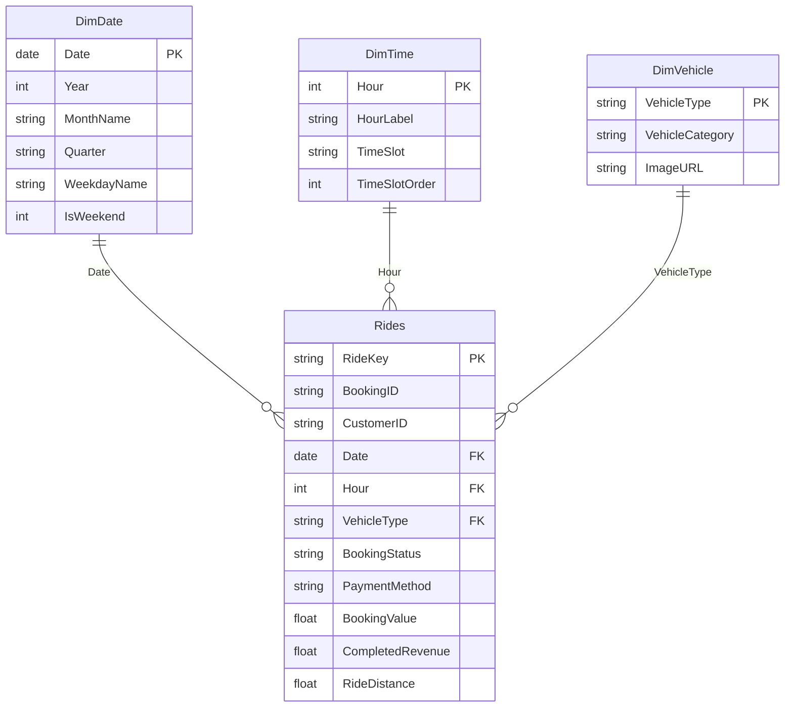

- **Grain:** `Rides` has one row per ride attempt (150,000 rows, 27 columns). `DimDate` has one row per day (1 January to 30 December 2024), `DimTime` one per hour (24), and `DimVehicle` one per vehicle type (7, with a category and an illustration).
- **Relationships:** three one-to-many relationships from the dimensions to `Rides`.
- **Helper tables:** `FunnelStages`, `ControlGroups`, `FareBands` and `Time Period` (a field parameter).
- **Measures:** all measures live in one table, `_Measures`.

---

## 12. Power BI build

### DAX measure reference

The main measures behind the dashboard's visuals, grouped by purpose (the model holds more than 40 in total). The formulas are in `dashboards/Uber_NCR_Ride_Operations.pbix`.

| Group | Measures |
|---|---|
| Volume and completion | Total Bookings, Completion Rate, Lost Bookings, Lost Share %, Bookings per Day |
| Cancellations | Customer Cancellations, Driver Cancellations, Customer Cancellation Rate, Driver Cancellation Rate, Control Share %, Driver Blame Text, Revenue at Risk |
| Funnel | Funnel Value, Funnel Share % |
| Demand | Peak Hour, Peak vs Quietest, Evening Share %, Avg Distance km, Total Distance km |
| Revenue | Revenue, Revenue (₹M), Revenue Share %, Revenue Previous Month, Revenue MoM %, Avg Fare, Median Fare, Fare Band Rides |
| Payments | Payment Share %, Digital Share % |
| Service quality | Avg VTAT, Avg CTAT, Avg Customer Rating, Avg Driver Rating |
| Interface and colour | Showing, Loss Color, Peak Hour Color, Top Month Color, Top Slot Color, Payment Color, Customer Reason Color, Driver Reason Color |

Examples of the DAX behind the dashboard:

```
Completion Rate = DIVIDE([Completed Rides], [Total Bookings])

Revenue = SUM(Rides[CompletedRevenue])

Bookings per Day = DIVIDE([Total Bookings], DISTINCTCOUNT(Rides[Date]))

Revenue at Risk =
    ([Customer Cancellations] + [Driver Cancellations] + [No Driver Found]) * [Avg Fare]

Evening Share % =
    DIVIDE(CALCULATE([Total Bookings], DimTime[TimeSlot] = "Evening Peak"), [Total Bookings])
```

### Interaction design

- **Fleet selector (Home):** seven vehicle buttons with hover and selected states. Each applies a bookmark that sets a vehicle filter on the Home page, so the KPI cards show that vehicle's numbers. An *All vehicles* button resets it, and the *Showing* measure labels the current selection.
- **Synced filters:** the date range and vehicle filters are synced across Overview, Demand, Cancellations and Revenue.
- **Month / Quarter toggle (Overview):** a field parameter that switches the bookings-per-day chart between twelve months and four quarters.
- **Data-driven colour rules:** the peak hour, the top revenue month, the largest loss cause and the UPI bar are highlighted by measures, so the highlight follows the data when filters change.

---

## 13. Requirements and user acceptance testing (UAT)

The full document is in [`docs/requirements-and-test-plan.md`](docs/requirements-and-test-plan.md). It was written **after the build**, with a fictional stakeholder, so it documents and verifies the dashboard rather than driving its design.

### Requirements summary

- **FR1:** 7 pages in a fixed order, with a page navigator on every page.
- **FR2:** date and vehicle slicers synced across Overview, Demand, Cancellations and Revenue.
- **FR3:** KPI cards show the headline figures on Home and Overview.
- **FR4:** Home fleet buttons filter the Home page and update the "Showing" label.
- **FR5:** Vehicles shows all 7 types side by side; Insights states findings, recommendations and data notes.
- **FR6:** Home and Insights state that the data is probably synthetic.
- **NFR:** pages load without visible delay; data covers 1 January to 30 December 2024.

### Requirements traceability

Each requirement is linked to the tests that check it.

| Requirement | Checked by | Status |
|---|---|---|
| **FR1** 7 pages in a fixed order, navigator on every page | T13, T17 | Passed |
| **FR2** Date and vehicle slicers synced across four pages | T14 | Passed |
| **FR3** KPI cards show the headline figures on Home and Overview | T1, T2, T3, T5, T6 | Passed |
| **FR4** Home fleet buttons filter Home and update the "Showing" label | T15, T16 | Passed |
| **FR5** Vehicles shows all 7 types; Insights states findings and notes | T9, T11 | Passed |
| **FR6** Home and Insights state the data is probably synthetic | T24 | Planned, not yet run |
| **NFR** Pages load without visible delay | T18 | Passed (an observation, not a stopwatch measurement) |
| **NFR** Data covers 1 January to 30 December 2024 | T25 | Planned, not yet run |

### User acceptance testing (UAT)

UAT asks a different question from a figure check: *can the intended user do the job the dashboard exists for?* The scenarios below use the two practice personas from section 2. Each scenario passes only if every test behind it passes.

| # | Scenario | Persona | Acceptance criteria | Tests | Result |
|---|---|---|---|---|---|
| UAT-1 | See how many bookings become rides | Operations Manager | Home and Overview show 150,000 bookings, 62.0% completion and ₹47.26M revenue; the funnel ends at 93.0K | T1, T2, T3, T5 | Pass |
| UAT-2 | Find out who causes cancellations | Operations Manager | Driver rate 18.0%, customer rate 7.0%, driver share 72% | T8 | Pass |
| UAT-3 | Know when to add drivers | Operations Manager | Peak hour 18:00 and 9.4x the quietest hour | T7 | Pass |
| UAT-4 | See what the loss costs | Operations Manager | 57K lost bookings and ₹24.4M revenue at risk | T6 | Pass |
| UAT-5 | Compare vehicle types | Analyst | Vehicle bookings add up to 150,000; completion 61.4% to 62.6% | T9 | Pass |
| UAT-6 | Pick one vehicle, then reset | Operations Manager | Home cards and the "Showing" label change for each vehicle; *All vehicles* restores the full figures | T15, T16 | Pass |
| UAT-7 | Move around and filter | Analyst | Seven pages in order, a working navigator from every page, and a date slicer that matches on all four filtered pages | T13, T14, T17 | Pass |
| UAT-8 | Trust the figures | Analyst | Statuses add up; UPI and digital shares are right; Insights figures match the data; repeated IDs are handled | T4, T10, T11, T12 | Pass |
| UAT-9 | Open pages without waiting | Analyst | Each page loads in under a second | T18 | Pass |

**Outcome:** 9 of 9 scenarios and 18 of 18 test cases passed, and two documentation defects were found and corrected (listed below).

| UAT summary | |
|---|---|
| Tested by | Harshvardhan Singh (author) |
| Stakeholder | Fictional (Operations Manager and Analyst personas) |
| Method | Figure checks recomputed from the data; one inspection of the report file; five checks run by hand in Power BI Desktop |
| Decision | Accepted for portfolio use |
| Limit | Run by the author with fictional stakeholders, so it demonstrates method, not real stakeholder sign-off |

### Test results

| ID | What was checked | Expected | Result |
|---|---|---|---|
| T1 | Total bookings on Home and Overview | 150,000 | Pass |
| T2 | Completion rate and completed funnel bar | 62.0% (93,000) | Pass |
| T3 | Revenue and average fare | ₹47.26M and ₹508 | Pass |
| T4 | All booking statuses add up | 150,000 | Pass |
| T5 | Booking funnel | 150.0K, 139.5K, 102.0K, 93.0K | Pass |
| T6 | Lost bookings and revenue at risk | 57K and ₹24.4M | Pass |
| T7 | Peak hour and peak vs quietest | 18:00 and 9.4x | Pass |
| T8 | Driver and customer cancellation rates; driver share | 18.0%, 7.0%, 72% | Pass |
| T9 | Vehicle bookings add up; completion range | 150,000; 61.4% to 62.6% | Pass |
| T10 | UPI and digital shares | 45.0% and 75.1% | Pass |
| T11 | Every figure quoted on Insights vs recomputed data | All match | Pass |
| T12 | `RideKey` unique; repeated booking IDs kept | Unique; 1,224 IDs repeat on 1,233 extra rides | Pass |
| T13 | Page order and navigators | 7 pages in order; navigator on each | Pass |
| T14 | Date slicer synced across Overview, Demand, Cancellations, Revenue | Same range on all four | Pass |
| T15 | Home fleet buttons update the label and cards | Changes for each vehicle | Pass |
| T16 | All vehicles resets Home | Cards return to full figures | Pass |
| T17 | Navigator opens the right page from every page | Correct page each time | Pass |
| T18 | Page load time | Each page under 1 second | Pass |

**How it was tested:** T1 to T12 are figure checks, recomputed from the data (`tests/verify_figures.py` reproduces them); T13 inspected the report file's structure; T14 to T18 were run by hand in Power BI Desktop (T18 is an observation, not a stopwatch measurement).

### Defects and corrections found while testing

1. **Wording on Insights (fixed).** The data-notes box said "1,233 booking IDs repeat." The data shows **1,224 IDs repeat across 1,233 extra rides**, and the wording was corrected.
2. **Requirements did not match the build (fixed).** The first draft of the requirements had the page order wrong, said filters apply to every page, described the vehicle selector as filtering every visual, expected a "72%" card on the Cancellations page, and expected no duplicate booking IDs. All were corrected to match the dashboard as built.

### Planned additional tests (not yet run)

These are written but have **not been run**, so they are not counted in the 18.

| ID | What will be checked | Expected |
|---|---|---|
| T19 | Vehicle filter flows through four pages (Auto only) | Overview, Demand, Cancellations and Revenue show Auto's figures (37,419 bookings, 61.9% completion, ₹11.73M); Home, Vehicles and Insights are unchanged |
| T20 | Date range flows through four pages (1 to 31 January) | 12,861 bookings, 61.8% completion, ₹4.00M revenue |
| T21 | Both filters together (Bike, 1 January to 31 March) | 5,706 bookings, 63.1% completion, ₹1.83M revenue |
| T22 | Edge case: a single day (1 January) | 414 bookings, 60.6% completion; no error, blank or 0K card |
| T23 | Home fleet selector, every vehicle | Each vehicle's bookings, completion, revenue and lost bookings match the data |
| T24 | Home and Insights state the data is probably synthetic (FR6) | The notice is visible on both pages |
| T25 | Date slicer range (NFR) | Starts 1 January 2024 and ends 30 December 2024 |

---

## 14. Validation and reconciliation

Every headline figure on the dashboard was recomputed from `powerbi_data/rides.csv`:

| Reconciliation | Result |
|---|---|
| Statuses: 93,000 + 27,000 + 10,500 + 10,500 + 9,000 | = 150,000 |
| Funnel: 150,000 - 10,500 - 27,000 - 10,500 - 9,000 | = 93,000 completed |
| Vehicle bookings: 37,419 + 29,806 + 27,141 + 22,517 + 18,111 + 10,557 + 4,449 | = 150,000 |
| Revenue at risk: 48,000 x ₹508.18 | = ₹24.39M, shown as ₹24.4M |
| Peak vs quietest: 12,397 / 1,321 | = 9.38, shown as 9.4x |
| Driver share: 27,000 / (27,000 + 10,500) | = 72.0% |
| Category revenue: 53.1% + 24.8% + 22.1% | = 100% |

To re-run the checks yourself:

```
python tests/verify_figures.py
```

It prints PASS or FAIL for 28 checks and exits with code 0 only if all of them pass.

---

## 15. Challenges and lessons learned

- **Repeated booking IDs.** Booking IDs are not unique, but the rows are different rides. I kept every row and added a `RideKey`. During testing I found the count was stated imprecisely (1,233 IDs vs 1,224 IDs creating 1,233 extra rides), which taught me to state exactly what is counted.
- **Defining the numbers.** "Revenue", "lost bookings" and "revenue at risk" each needed a written definition, because incomplete rides (₹4.59M) and the average-fare assumption change the story.
- **Static insight text.** The Insights page is typed text, so it will not update if the data changes. Test T11 exists to catch drift between that text and the data.
- **Writing requirements after the build.** My first draft described the dashboard from memory and was wrong in several places. Checking it against the report file and the data fixed that.
- **Telling a story from flat data.** Nearly everything is evenly distributed in this dataset, so the honest finding is "volume differs, performance does not", plus a clear synthetic-data warning.

---

## 16. Limitations and caveats

- **The data looks synthetic.** Findings describe this dataset, not Uber's real business.
- **Revenue at risk is an estimate.** It assumes each lost booking would have paid the average fare.
- **Fares do not track distance** (correlation 0.006), so revenue per kilometre is not reported as a KPI.
- **VTAT and CTAT are not documented** in the dataset, so they are shown by name only.
- **Customers almost never repeat** (1,206 of 148,788), so there is no customer-segment analysis.
- **Cancellation reasons are shown as recorded.** They do not prove who was really at fault.
- **No 31 December rides.** The date range ends on 30 December 2024.
- **Insights text is static.**
- **Testing was done by the author.** The requirements and user acceptance tests use a fictional stakeholder, so they demonstrate method, not real stakeholder sign-off.

---

## 17. Future work

These are ideas, not completed work.

- Make the Insights text measure-driven so it updates with the filters.
- Run `tests/verify_figures.py` automatically on every push (for example with GitHub Actions).
- Repeat the analysis on real ride data and compare which patterns survive.
- Add a customer-level view if a dataset with repeat customers becomes available.
- Test the pickup-confirmation idea with a real before-and-after measurement.

---

## 18. Repository structure

```
uber-ncr-ride-operations/
├── README.md
├── ncr_ride_bookings.csv           raw dataset
├── uber_ride_analysis.ipynb        cleaning, audit, exploration, exports
├── powerbi_data/                   rides.csv and the three dimension tables loaded into Power BI
├── charts/                         10 charts exported from the notebook
├── dashboards/                     Uber_NCR_Ride_Operations.pbix
├── assets/                         background, icons, vehicle illustrations
├── tests/
│   └── verify_figures.py           recomputes 28 dashboard figures from the data
└── docs/
    ├── requirements-and-test-plan.md   requirements, KPI definitions and 18 test cases
    ├── uber_data_analytics.pdf         all pages in one file
    └── screenshots/                    one image per dashboard page
```

---

## 19. How to reproduce this project

**Prerequisites:** Python 3.9 or later with pandas, NumPy, matplotlib, seaborn and Jupyter; Power BI Desktop (Windows).

1. Clone the repository: `git clone https://github.com/CryptedBlade/uber-ncr-ride-operations.git`
2. Install the packages: `pip install pandas numpy matplotlib seaborn jupyter`
3. Open `uber_ride_analysis.ipynb` in Jupyter and run all cells. It cleans the data, runs the audit, saves the charts and writes the four tables to `powerbi_data/`.
4. Open `dashboards/Uber_NCR_Ride_Operations.pbix` in Power BI Desktop. If Power BI asks for the data location, point it at the files in `powerbi_data/`.
5. Check the figures: `python tests/verify_figures.py`

---

## 20. Skills demonstrated

- **Python data work:** cleaning, feature engineering, auditing and exploratory analysis with pandas.
- **Data modelling:** star schema design, grain, relationships and helper tables.
- **Power BI:** Power Query, DAX measures, bookmarks, field parameters, synced slicers and conditional formatting.
- **Dashboard design:** a consistent theme, navigation, and colour used to carry meaning.
- **Requirements and testing:** KPI definitions, functional and non-functional requirements, test cases and user acceptance testing.
- **Verification:** an independent script that reproduces the dashboard's figures from the data.
- **Honest communication:** estimates labelled as estimates, and synthetic data labelled as synthetic.

---

## 21. Glossary

| Term | Meaning |
|---|---|
| **Completion rate** | Completed bookings divided by total bookings |
| **Lost booking** | A booking that was cancelled by the customer or driver, had no driver found, or was incomplete |
| **Revenue at risk** | An estimate: cancelled and no-driver bookings multiplied by the average fare |
| **Evening Peak** | The time slot from 15:00 to 20:59 |
| **VTAT, CTAT** | Wait-time fields in the dataset; their exact meaning is not documented |
| **Star schema** | A fact table linked to dimension tables in one-to-many relationships |
| **Field parameter** | A Power BI feature that lets a visual switch between fields, used here for Month/Quarter |
| **Bookmark** | A saved state of a report page, used here for the fleet selector |
| **Slicer** | An on-page filter control |
| **UAT** | User acceptance testing |

---

## 22. Data source and credits

- **Dataset:** public Kaggle dataset of Delhi NCR ride bookings (`ncr_ride_bookings.csv`). Check the dataset's page for its licence before reusing it.
- **Dashboard design, analysis, vehicle illustrations and icons:** original work for this project.

---

## 23. Author

**Harshvardhan Singh**

- GitHub: [CryptedBlade](https://github.com/CryptedBlade)
- LinkedIn: [linkedin.com/in/harshhhhhh](https://linkedin.com/in/harshhhhhh)
- Portfolio: [harshhhhhdata.lovable.app](https://harshhhhhdata.lovable.app)
