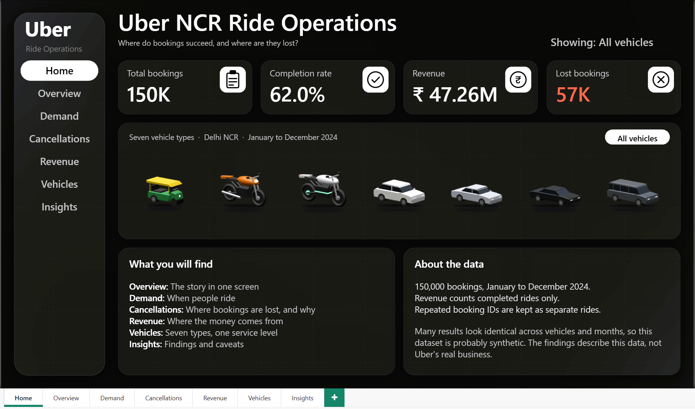
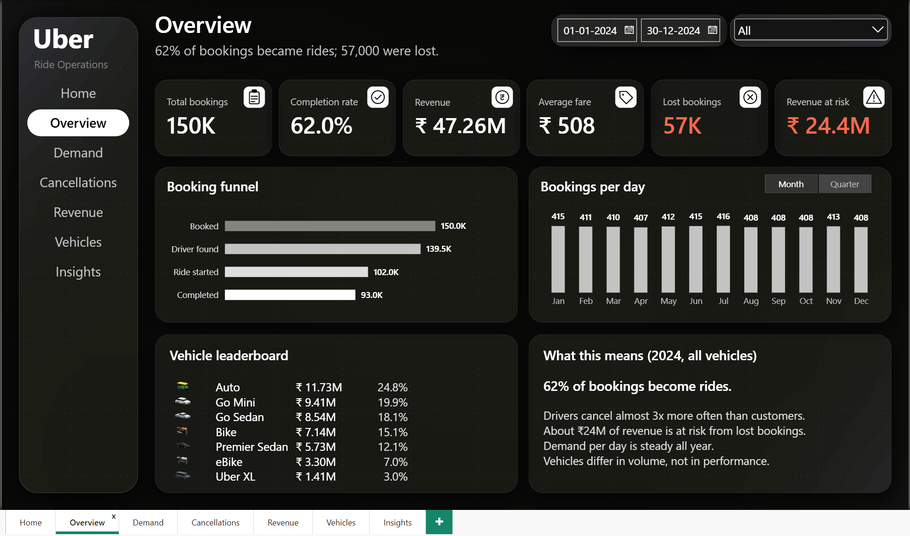
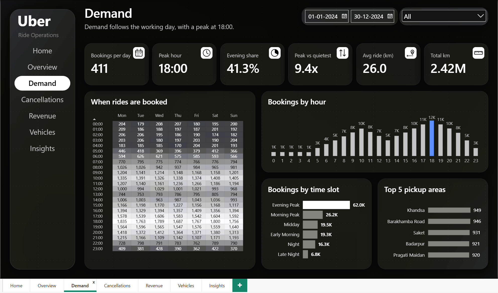
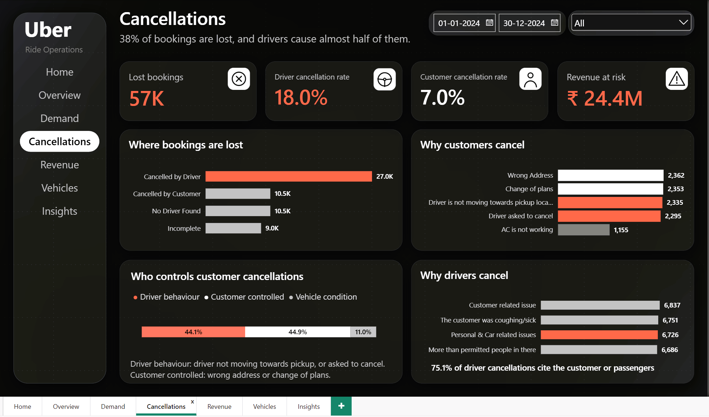
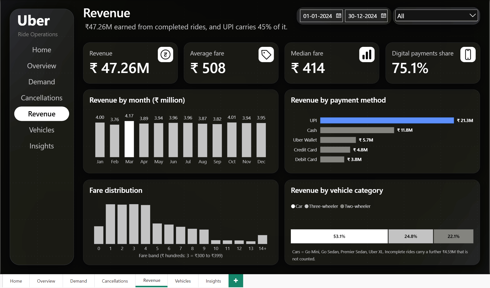
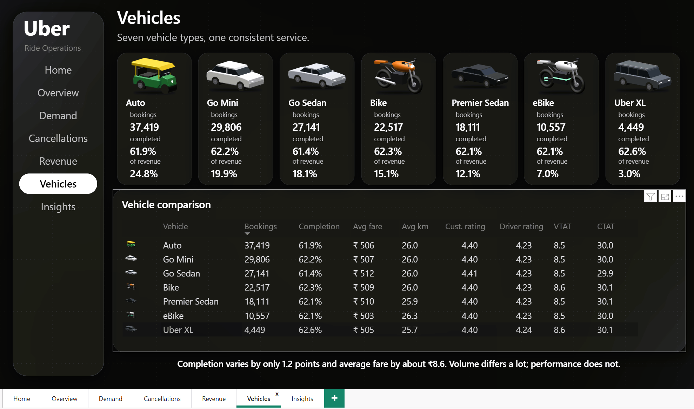
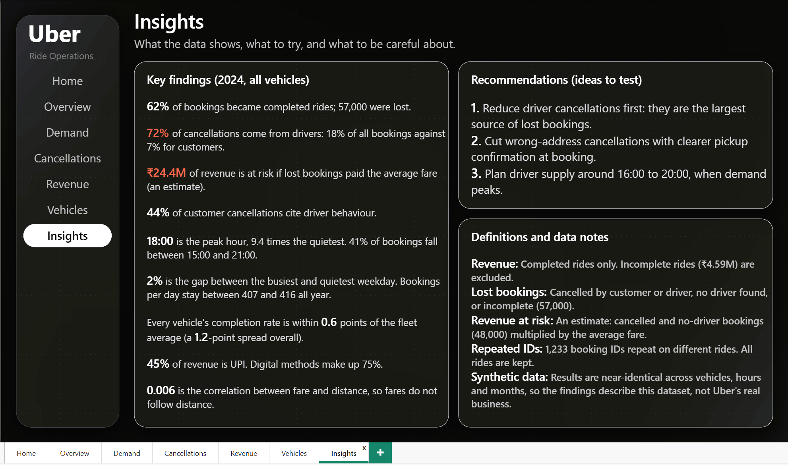

# Uber NCR Ride Operations Dashboard

An end-to-end analytics project on 150,000 ride bookings from Delhi NCR (January to December 2024).
Raw data is cleaned and audited in **Python**, modelled as a **star schema** in **Power BI**, and delivered as a
**7-page interactive dashboard** that follows one question: *where do bookings succeed, and where are they lost?*

> Independent portfolio project. It is not affiliated with or endorsed by Uber. The vehicle illustrations and icons were drawn for this project.



---

## Headline findings

| Finding | Evidence |
|---|---|
| Only **62.0%** of bookings became completed rides | 93,000 of 150,000; 57,000 were lost |
| Drivers cause **72%** of cancellations | Drivers cancelled 18.0% of all bookings, customers 7.0% |
| About **₹24.4M** of revenue is at risk (estimate) | 48,000 cancelled or no-driver bookings x ₹508 average fare |
| **44%** of customer cancellations cite driver behaviour | 4,630 of 10,500 (driver not moving towards pickup, or asked to cancel) |
| **75%** of driver cancellations cite the customer or passengers | As recorded in the data |
| Demand peaks at **18:00**, 9.4x the quietest hour | 12,397 bookings against 1,321 at 04:00; 41.3% of rides fall between 15:00 and 20:59 |
| Demand per day is flat all year | 407 to 416 bookings a day in every month |
| Revenue is **₹47.26M** (completed rides only) | Average fare ₹508, median fare ₹414 |
| **UPI is 45.0%** of revenue; digital methods are 75.1% | Cash is 24.9% |
| Vehicles differ in volume, not in performance | Completion 61.4% to 62.6%; average fare ₹503 to ₹512 |
| Fares do not follow distance | Correlation 0.006 |

---

## Dashboard pages

| Page | Question it answers | Main visuals |
|---|---|---|
| **Home** | What is this, and where do I start? | KPI cards, interactive fleet selector, data notes |
| **Overview** | What is the story in one screen? | Six KPI cards, booking funnel, bookings per day (month / quarter toggle), vehicle leaderboard |
| **Demand** | When do people ride? | Hour-by-weekday heatmap, bookings by hour, by time slot, top 5 pickup areas |
| **Cancellations** | Where are bookings lost, and why? | Lost bookings by cause, customer and driver reasons, who controls customer cancellations |
| **Revenue** | Where does the money come from? | Monthly revenue, payment methods, fare distribution, revenue by vehicle category |
| **Vehicles** | Do vehicle types perform differently? | Seven vehicle tiles, comparison table |
| **Insights** | What should the viewer take away? | Findings, recommendations, definitions and caveats |

| | |
|---|---|
|  |  |
|  |  |
|  |  |

---

## Interactive features

- **Fleet selector (Home):** seven vehicle buttons with hover and selected states. Each applies a bookmark that filters the page, so the KPI cards show that vehicle's numbers. An *All vehicles* button resets it.
- **Synced filters:** a date range and a vehicle filter that apply across Overview, Demand, Cancellations and Revenue.
- **Month / Quarter toggle:** a field parameter that switches the bookings-per-day chart between twelve months and four quarters.
- **Dynamic colour rules:** the peak hour, the top revenue month, the largest loss cause and the UPI bar are highlighted by measures, so the highlight follows the data when filters change.

---

## How the data was prepared (Python)

The analysis lives in `uber_ride_analysis.ipynb`.

1. **Loaded and profiled** the raw CSV (150,000 rows, 21 columns). Blanks are meaningful: a cancelled ride has no fare or rating.
2. **Cleaned IDs and dates:** removed stray quote marks from Booking and Customer IDs; converted date and time text into real timestamps.
3. **Handled repeated booking IDs:** 1,233 IDs repeat across 2,457 rows, but no two rows are identical, so they are different rides that share a number. All were kept and each row got its own `RideKey`.
4. **Engineered features:** hour, weekday, month, quarter, time slot, distance band, and one 1/0 flag per booking outcome.
5. **Defined revenue** as completed rides only. Incomplete rides carry a further ₹4.59M in booking value that is excluded.
6. **Audited data quality:** ratings sit between 3 and 5, fares between ₹50 and ₹4,277, distances between 1 and 50 km; no cancelled or no-driver ride has a fare; the outcome flags agree with the status text.
7. **Explored and charted** demand, cancellations, vehicles, payments, fares and ratings (ten charts saved in `charts/`), then **exported four tidy tables** for Power BI.

---

## Data model (Power BI)

```
DimDate    (one row per day, 1 Jan to 30 Dec 2024) ──┐
DimTime    (24 hours, with time slots)             ──┼── one-to-many ──  Rides
DimVehicle (7 vehicle types, with category)        ──┘                   (150,000 rows, 27 columns)

Helper tables: FunnelStages, ControlGroups, FareBands, Time Period (field parameter)
All measures live in one table: _Measures
```

`dim_date.csv` runs to 31 Dec; the model trims it to the last ride date (30 Dec) in Power Query.

Examples of the DAX behind the dashboard:

```
Completion Rate = DIVIDE([Completed Rides], [Total Bookings])

Revenue = SUM(Rides[CompletedRevenue])

Bookings per Day = DIVIDE([Total Bookings], DISTINCTCOUNT(Rides[Date]))

Revenue at Risk =
    ([Customer Cancellations] + [Driver Cancellations] + [No Driver Found]) * [Avg Fare]

Evening Share % =
    DIVIDE(CALCULATE([Total Bookings], DimTime[TimeSlot] = "Evening Peak"), [Total Bookings])
```

---

## Limitations and data notes

- **The data looks synthetic.** Completion rate, average fare, ratings, wait times and hourly patterns are almost identical across vehicles, months and locations, which real ride data rarely shows. The findings describe this dataset, not Uber's real business.
- **Fares do not track distance** (correlation 0.006), so revenue per kilometre is not reported as a KPI.
- **Revenue at risk is an estimate.** It assumes each lost booking would have paid the average fare.
- **VTAT and CTAT are not documented** in the dataset, so they are shown by name only.
- **Customers almost never repeat** (1,206 of 148,788 booked more than once), so there is no customer-segment analysis.
- Cancellation reasons are shown **as recorded** in the data.

---

## Repository structure

```
Uber_Data_Analytics/
├── README.md
├── ncr_ride_bookings.csv          raw dataset
├── uber_ride_analysis.ipynb       cleaning, audit, exploration, exports
├── powerbi_data/                  rides.csv and the three dimension tables loaded into Power BI
├── charts/                        charts exported from the notebook
├── dashboards/                    Uber_NCR_Ride_Operations.pbix
├── assets/                        background, icons, vehicle illustrations
└── docs/
    ├── uber_dashboard.pdf    all pages in one file
    └── screenshots/               one image per dashboard page
```

---

## Tools

Python (pandas, NumPy, matplotlib, seaborn) · Jupyter · Power BI Desktop · DAX · Power Query

## Credits

- Dataset: public Kaggle dataset of Delhi NCR ride bookings (`ncr_ride_bookings.csv`).
- Dashboard design, analysis, vehicle illustrations and icons: original work for this project.

## Author

**Harshvardhan Singh**

- GitHub: [CryptedBlade](https://github.com/CryptedBlade)
- LinkedIn: [linkedin.com/in/harshhhhhh](https://linkedin.com/in/harshhhhhh)
- Portfolio: [harshhhhhdata.lovable.app](https://harshhhhhdata.lovable.app)
